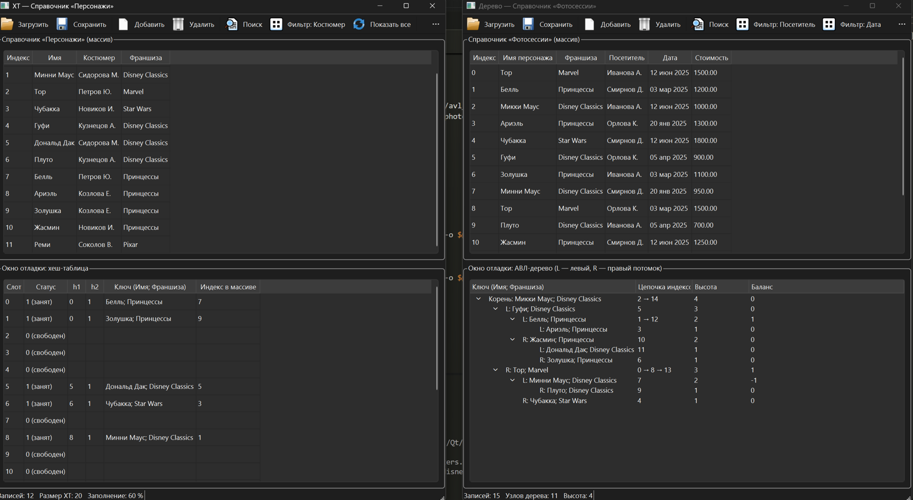
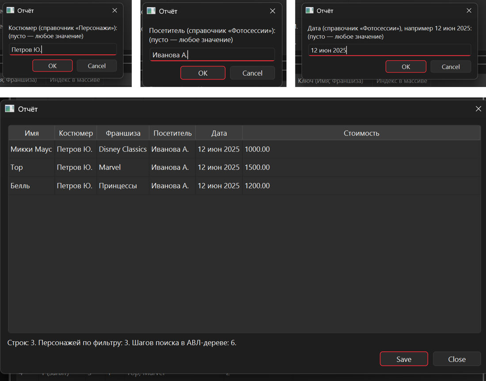
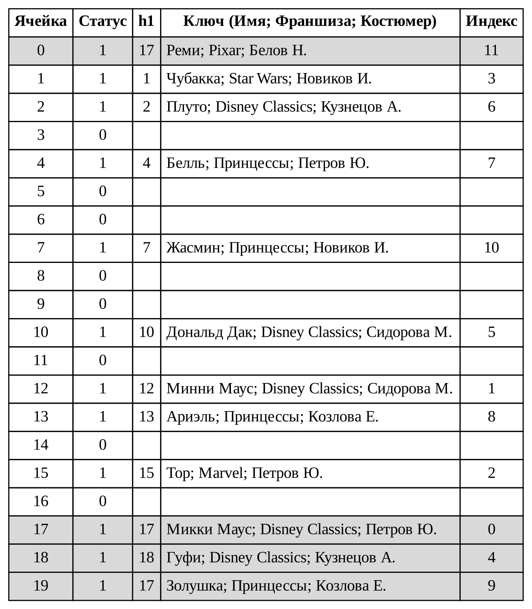
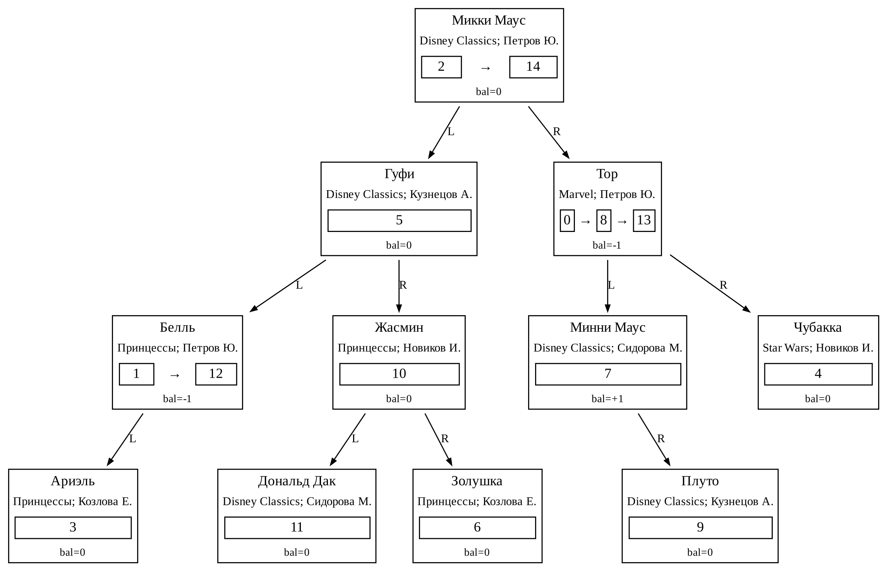

# Информационная система «Диснейленд»

Курсовой проект по дисциплине «Алгоритмы и структуры данных в приложениях»
(ДВФУ, ИМКТ, «Программная инженерия», 2026).

Desktop-приложение для учёта персонажей парка и фотосессий с ними.
Записи справочников хранятся в массивах, а быстрый поиск обеспечивают
собственные реализации структур данных, которые хранят пары «ключ → индекс в массиве»:

| Справочник | Структура | Ключ |
|---|---|---|
| Персонажи | статическая хеш-таблица, открытая адресация | Имя + Франшиза + Костюмер (уникальный) |
| Фотосессии | АВЛ-дерево, цепочка индексов в узле | Имя + Франшиза + Костюмер (неуникальный) |

Отчёт «Фотосессии персонажей» строится по фильтрам: костюмер, посетитель, дата.

**Стек:** C++17, Qt 6 (Widgets), CMake, MinGW (GCC).



*Слева — справочник «Персонажи» и состояние хеш-таблицы, справа — «Фотосессии» и АВЛ-дерево.*



*Отчёт по фильтрам: костюмер, посетитель, дата.*

## Возможности

- Загрузка справочников из текстовых файлов, добавление, удаление и поиск записей.
- Контроль целостности: нельзя удалить персонажа, у которого есть фотосессии.
- Окно отладки показывает внутреннее состояние структур: ячейки хеш-таблицы
  (статус, h1, ключ, индекс) и узлы АВЛ-дерева (ключ, цепочка индексов, bal).
- Генератор согласованных тестовых данных (`generator.cpp`).

## Структуры данных

**Хеш-таблица.** Ключ сворачивается суммой кодов символов, затем применяется
мультипликативная хеш-функция Кнута; коллизии разрешаются линейным пробированием
с шагом 1. Статусы ячеек: 0 — свободна, 1 — занята, 2 — удалена.



**АВЛ-дерево.** Балансировка по Н. Вирту: показатель `bal` и признак изменения
высоты, повороты LL, RR, LR, RL. Записи с одинаковым ключом хранятся
односвязным списком индексов в одном узле.



## Структура проекта

```
core/        ядро без Qt: дата, ключ, хеш-таблица, АВЛ-дерево, хранилище, отчёт
gui/         окна Qt Widgets: «Персонажи» (ХТ) и «Фотосессии» (дерево)
tests/       тесты ядра: структуры данных и функциональные
examples/    примеры входных файлов
generator.cpp  генератор входных данных
```

Ядро собирается как отдельная статическая библиотека `disney_core` и тестируется без Qt.

## Сборка и запуск (Windows, Qt 6 + MinGW)

Нужны Qt 6 с MinGW, CMake и make. Путь к Qt задаётся в `Makefile`
(по умолчанию `C:/Qt/6.11.2/mingw_64`), его можно переопределить: `make gui QT=путь`.

```
make gui      # собрать GUI, скопировать DLL и запустить
make run      # запустить уже собранный GUI
make tests    # собрать и прогнать тесты ядра (Qt не нужен)
make clean    # удалить сборку
```

## Тесты

Тесты не используют сторонних фреймворков:

- `tests_structures` — хеш-таблица и АВЛ-дерево, включая 6000 случайных
  вставок и удалений с проверкой показателей `bal` (54 проверки);
- `tests_functional` — справочники, целостность данных и отчёт (70 проверок).

## Формат входных файлов

```
Персонажи:  Имя;Костюмер;Франшиза
Фотосессии: ИмяПерсонажа;Франшиза;Костюмер;Посетитель;ДД мес ГГГГ;Стоимость
```

Примеры лежат в `examples/`.
